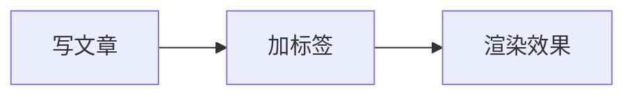

# 标签插件

写文章时，用 `:::名称{参数}` 这样的容器指令就能插入下面这些块。
每组先给效果，再给可以直接复制的写法。

## box 提示块

:::box{color="blue" title="提示"}
这是一个 box 标签，适合放提示、补充说明。
:::

```markdown
:::box{color="blue" title="提示"}
这是一个 box 标签，适合放提示、补充说明。
:::
```

可选颜色：`red` / `orange` / `yellow` / `green` / `cyan` / `blue` / `purple`。

## note 备注块（box 的别名）

:::note{color="cyan" title="备注"}
note 和 box 共用同一份实现，写哪个都行，样式完全一样。
:::

```markdown
:::note{color="cyan" title="备注"}
note 和 box 共用同一份实现，写哪个都行，样式完全一样。
:::
```

## tip 提示条

:::tip 小提示
第一个位置可以写标题，后面是正文。同类的还有 `important`、`caution`、`warning`。
:::

```markdown
:::tip 小提示
第一个位置可以写标题，后面是正文。同类的还有 important、caution、warning。
:::
```

:::warning 注意
`tip`、`important`、`caution`、`warning` 四种颜色不同，用来说明不同程度的提醒。
:::

```markdown
:::warning 注意
tip、important、caution、warning 四种颜色不同，用来说明不同程度的提醒。
:::
```

## button 按钮

::button{color="blue" text="点我试试" url="#"}

```markdown
::button{color="blue" text="点我试试" url="#"}

::button{color="green" size="sm" text="小号按钮" url="#"}

::button{color="red" size="lg" text="大号按钮" url="#"}
```

## folding 折叠块

:::folding{title="点开看看" color="yellow"}
折叠起来的内容，适合放长代码或补充材料。
:::

```markdown
:::folding{title="点开看看" color="yellow"}
折叠起来的内容，适合放长代码或补充材料。
:::
```

`open=true` 可以让它默认展开。

## frame 图片边框

:::frame{device="demo-frame" img="https://picsum.photos/seed/frame/640/360" alt="示例图片"}
:::

```markdown
:::frame{device="demo-frame" img="/images/your-image.png" alt="示例图片"}
:::
```

`device` 用来生成包裹层的 id，`img` / `video` 二选一。

## poetry 诗词

:::poetry{title="静夜思" author="李白"}
床前明月光，
疑是地上霜。
举头望明月，
低头思故乡。
:::

```markdown
:::poetry{title="静夜思" author="李白"}
床前明月光，
疑是地上霜。
举头望明月，
低头思故乡。
:::
```

## paper 纸张

:::paper{title="示例文档" author="绮曜" date="2026"}
---
正文段落，会带首行缩进。
---
## 注释
页脚处的补充说明。
:::

```markdown
:::paper{title="示例文档" author="绮曜" date="2026"}
---
正文段落，会带首行缩进。
---
## 注释
页脚处的补充说明。
:::
```

`style="underline"` 会给整块加上横线稿纸背景。

## chat 对话

:::chat{title="三个角色的对话" me="557"}
- 557: 你回来啦。
- 245: 嗯，今天把灯箱修好了。
- 670: 修好了？我看看。
- 557: 自己点开图看。
:::

```markdown
:::chat{title="三个角色的对话" me="557"}
- 557: 你回来啦。
- 245: 嗯，今天把灯箱修好了。
- 670: 修好了？我看看。
- 557: 自己点开图看。
:::
```

左右规则：

- 不写参数时，两个人以内按说话人交替
- `me="名字"` 让这个人固定站在右边，其余在左边
- `left="A, B"` / `right="C"` 可以显式指定
- 三个人以上又没给 `me` 时，全部靠左，退化成群聊
- `avatars="名字:/图片地址, 名字:/图片地址"` 可以配头像；没配的人用名字首字当徽标

## check 勾选

:::check{checked="true" color="green"}
已经做到的事。
:::

:::check{checked="false" color="red"}
还没做到的事。
:::

```markdown
:::check{checked="true" color="green"}
已经做到的事。
:::
```

## mermaid 流程图



````markdown

````

流程图用标准 mermaid 代码块，不需要 `:::`。

## meting 音乐

::meting{server="netease" type="playlist" id="6851447315" list-folded="true"}

```markdown
::meting{server="netease" type="playlist" id="6851447315" list-folded="true"}
```

需要在 `site.ts` 里配置 meting 的 API 地址，否则只显示播放器外壳。

## code-group 代码分组

::: code-group labels=[JavaScript, Python]
```js
const list = [1, 2, 3];
console.log(list);
```
---
```py
list = [1, 2, 3]
print(list)
```
:::

````markdown
::: code-group labels=[JavaScript, Python]
```js
const list = [1, 2, 3];
```
---
```py
list = [1, 2, 3]
```
:::
````

注意 `:::` 后面有一个空格，面板之间用 `---` 分隔。

## tabs 分栏

分栏和上面的 code-group 是**同一个标签**，区别只在面板里放什么：这里放任意 markdown，不只是代码。
仍然用 `::: code-group labels=[...]`，面板之间用 `---` 分隔 —— 友链页就是这么用的。

::: code-group labels=[第一栏, 第二栏]

**第一栏的内容**

可以放文字、列表、图片。

---

**第二栏的内容**

也可以放代码：

```js
console.log("hi")
```

:::

````markdown
::: code-group labels=[第一栏, 第二栏]

**第一栏的内容**

可以放文字、列表、图片。

---

**第二栏的内容**

也可以放代码：

```js
console.log("hi")
```

:::
````

## spoiler 悬停显示

:::spoiler
鼠标移上去才看得到的文字
:::

```markdown
:::spoiler
鼠标移上去才看得到的文字
:::
```

## details 点击折叠

<details>
<summary>点开看看</summary>
<p>被折叠起来的内容，点标题才展开。</p>
</details>

```html
<details>
<summary>点开看看</summary>
<p>被折叠起来的内容，点标题才展开。</p>
</details>
```

`spoiler` 是悬停显示，`details` 是点击展开，按需要选。

---

还有 `stnote`（等价于 note）、`important` / `caution` 等，写法同上。
